# How the characters are drawn

This guide records what the reference library shows about how these characters are drawn: the
art style, the body, the clothes and the faces, and how each of those is expressed as Canvas
drawing. It is written from the 107 traced figures in `traces/` and their 56 source images in
`originals/`.

Contents

1. [What this is based on](#1-what-this-is-based-on)
2. [How a drawing is stored and drawn on Canvas](#2-how-a-drawing-is-stored-and-drawn-on-canvas)
3. [The art style](#3-the-art-style)
4. [The body](#4-the-body)
5. [Clothes](#5-clothes)
6. [Faces](#6-faces)
7. [Hair](#7-hair)
8. [Character sheets](#8-character-sheets)
9. [Drawing a new character in this style](#9-drawing-a-new-character-in-this-style)
10. [Where the current generators depart from the references](#10-where-the-current-generators-depart-from-the-references)
11. [What is uncertain or missing](#11-what-is-uncertain-or-missing)

---

## 1. What this is based on

### Sources

| Kind | Images | Use |
|---|---|---|
| Full-body sheets in the show's style | 04–09, 11–16, 53 | Body, clothes, proportions, colour. 04, 05, 07 and 53 are photographs of printed pages, so their colours are shifted. 12 and 13 carry an artist signature. |
| Show screenshots (close-ups) | 17–20, 24, 26–29, 34–41, 43, 45–52 | Faces, line weight, face shading. Colours carry the scene's lighting. |
| Step-by-step tutorial drawings | 01–03, 10, 22, 23, 25, 44, 56 | Construction of the face and figure. Much heavier outlines than the show. |
| Sketches and other fan art | 21, 30–33, 42, 54, 55 | Head construction at many angles (Bolin), extra views. Not show-accurate in line or colour. |

Characters covered: Korra (two outfits), Mako, Bolin (two outfits), Asami (three outfits), Kuvira
and a female metalbender officer.

### How things were measured

- **Colours, areas, layer counts, shading differences**: computed from the trace data.
- **Line weight**: run lengths of the ink layer in a rasterised trace.
- **Body proportions**: read off a grid in head units laid over the front traces
  ([women](guide/body_grid_women.jpg), [men and armour](guide/body_grid_men_armour.jpg)).
  The head (crown to chin) was located by eye on small, blotchy heads, so head counts are good to
  about ±0.3 heads and positions to about ±0.1 head.
- **Face proportions**: read off a pixel grid laid over nine front faces
  ([1](guide/face_grid_korra_asami.jpg), [2](guide/face_grid_mako_bolin.jpg),
  [3](guide/face_grid_bolin_kuvira_asami.jpg)), plus [3/4](guide/face_grid_three_quarter.jpg) and
  [side](guide/face_grid_profile.jpg) views. Good to a few percent.

Where a statement is an observation rather than a measurement, it is worded as one.

---

## 2. How a drawing is stored and drawn on Canvas

There are two structures in the library. They draw the same picture in very different ways.

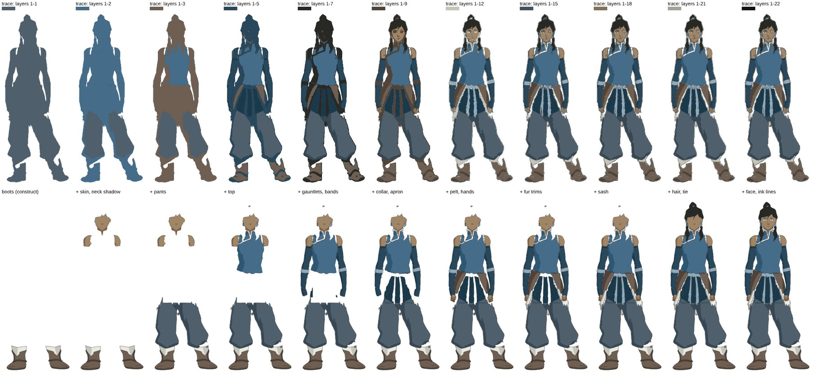
*Top row: the raw trace, colour layer by colour layer. Bottom row: the clean named parts, back to front.*

### 2.1 Raw trace (`traces/<id>.js`, all 107 figures)

```
{ id, src, box, character, sex, view, outfit, width, height,
  palette: ['#rrggbb', ...],      // 22 flat colours (4–6 for line drawings, up to 30 with detail colours)
  order:   [paletteIndex, ...],   // drawing order: largest area first, ink last
  paths:   [[paletteIndex, [ring, ...]], ...] }   // ring = x, y, sharp, x, y, sharp, ...
```

Drawn by `tools/render_lib.js` with five calls only:

```js
for (const [ci, rings] of trace.paths) {
  ctx.beginPath();
  for (const r of rings) ringPath(ctx, r);   // moveTo + bezierCurveTo per point + closePath
  ctx.fillStyle = palette[ci];
  ctx.fill('evenodd');                       // first ring = outline, the rest = holes
}
```

- Points are joined as smooth curves (Catmull-Rom, tangent = (next − previous) / 6), except at
  points flagged `sharp`, where the tangent is zero. On the body traces 20–49% of points are sharp.
- **Layers are stacked, not separate.** Layer 1 is the whole silhouette in the colour that covers
  the most area. Layer 2 is everything except that colour, and so on. The last layer is the ink.
- A path therefore never means "the sleeve" or "the eye". A section exists only as what is left
  visible of a colour after later layers cover it.
- No strokes, clips, gradients or transforms are used.

Consequences:

- Two sections with the same colour are one layer and cannot be separated: Mako's hair, pants,
  gloves, belt and shoes are a single layer (32% of the figure); Asami's hair and boots fall into
  the ink layer.
- The 22 palette slots are not 22 materials. Near-duplicates from image compression and tiny specks
  fill many of them; a figure has 5–14 real materials.
- Each view has its own palette. The same garment differs slightly between front, side and back.
- Small features are fragmented. One eye-and-brow band is 150–480 shapes in a screenshot trace.

### 2.2 Clean parts (`clean/korra_pair_front.json`, one figure)

```
{ id, width, height, ink, outline_width,
  parts: [{ name, z, fill, paths, tones: [{fill, paths}], outline, bbox }, ...],
  lines: [{ d, w }, ...],          // interior ink lines, stroked
  face:  { template, anchor, scale, colors, brows, ... },
  construct: [{ type: 'hand' | 'furBoot', z, ... }] }
```

Drawn by `tools/clean_lib.js`, one part at a time in `z` order:

```js
ctx.fillStyle = part.fill;  ctx.fill(path, 'evenodd');     // flat base
ctx.save(); ctx.clip(path, 'evenodd');                     // shadow shapes cannot leave the part
for (const t of part.tones) { ctx.fillStyle = t.fill; ctx.fill(tonePath, 'evenodd'); }
ctx.restore();
ctx.strokeStyle = ink; ctx.lineWidth = 0.7; ctx.stroke(path);   // thin outline
```

Korra's 47 parts, back to front:

| z | Part | Pieces | Outline curves | Shadow shapes |
|---|---|---|---|---|
| 9 | boots (built by rule, not traced) | 2 | – | – |
| 10 | skin (face, two shoulders), neck shadow, nose tip | 5 | 81 | 3 |
| 12 | pants | 2 | 99 | 1 |
| 20 | top | 6 | 95 | 3 |
| 25–26 | arm sleeves and their light bands | 8 | 106 | 7 |
| 30 | collar, apron panels | 10 | 138 | 4 |
| 32 | pelt (+ hands, built by rule) | 2 | 45 | 2 |
| 33 | fur trims | 8 | 163 | 5 |
| 34 | sash | 1 | 47 | 1 |
| 35–36 | hair, hair tie | 5 | 69 | 0 |
| last | face template, then 24 interior ink lines | | | |

About 1,300 curves in all, against 44,000 points for the raw trace of the same figure.

The face is a measured template (`FACE_TEMPLATES.lok_female`): about a dozen shapes per eye.
Hands and fur boots are constructions in `style/lok_style.js`, placed with a transform.

### 2.3 Which to use for what

- The raw traces are the evidence: they show exactly where every colour and edge is.
- The clean-part structure is the model of how the style works: closed forms, one shadow each,
  thin outline, stacked back to front. Section 9 builds on it.

---

## 3. The art style

These rules hold across every show-style figure in the library.

### 3.1 Shapes

- Every form is a closed flat shape. Volume comes from one shape overlapping another, not from
  lines or blending inside a shape.
- Contours are long, slightly curved runs that end in sharp corners. There are few fully round
  shapes outside the eyes and the skull.
- Edges of soft things are still drawn hard: fur is a zig-zag of pointed tufts, hair ends in
  points, cloth hems are clean curves.

### 3.2 Colour

- Flat colour only. No gradients, no texture.
- Colours are muted. Main garments have low colour strength (Lab chroma 3–21). Each character has
  at most one stronger accent: Mako's scarf (chroma 40), Bolin's vest (30), Asami's gown (42–52).
- Clothes are dark to mid (lightness 15–45). Skin is the lightest large area (57–78). Whites are
  trims only (79–95).
- A figure has 5–14 materials. Korra, with the most layered outfit, has 14; uniforms have 5–9.

### 3.3 Shading

Each material is one base tone plus one shadow tone of the same hue. Measured over 53 base/shadow
pairs:

| Base lightness (L) | Shadow is darker by |
|---|---|
| under 25 (dark cloth) | about 7.5 |
| 25–45 | about 9 |
| 45–65 | about 13 |
| 65 and up (skin, whites) | about 16 |

- Hue and colour strength barely change between base and shadow.
- The shadow is a hard-edged shape, never inked along its edge.
- On the body sheets the light comes from the viewer's upper right: the shadow is a strip down the
  viewer's left side of each form, plus a band under anything that overlaps it (under the collar,
  under the belt, under a hem, under the jaw).
- On a main garment the shadow shape is 15–25% as large as the base area (median over all pairs
  32%, because small parts are shadowed more heavily).
- Metal is the exception: Kuvira's armour uses four greys
  (`#5b5d58`, `#767974`, `#91938e`, `#bec1bb`) as plane-by-plane facets.
- Hair usually has no shadow tone at all.

### 3.4 Line

- One ink colour per figure, near black with a slight tint (`#0f1514`, `#171814`, `#1f1712`).
- Line weight in show close-ups is about 0.35–0.6% of head height, which is about 0.05–0.07% of
  body height. On the body sheets the lines are at the limit of the image resolution (one pixel,
  0.12–0.2% of figure height), so those figures only give an upper bound.
- Tutorial and fan drawings use lines three to ten times heavier. They are not a guide to line
  weight.
- Every form has an outline. Interior lines are few: a seam, two to four short folds where cloth
  gathers, a knuckle crease. There is no hatching.

### 3.5 What a figure is made of, by area

Typical share of the figure's area on a front view:

| Material | Share |
|---|---|
| Largest single material (usually the main garment) | 19–40% |
| Second largest | 13–20% |
| Other garments | 5–12% each |
| Skin | 2–5% (9% in Asami's gown) |
| Hair | 3–5% (more for Asami) |
| Trims, bands, accents | 1–3% each |
| Ink, where it is not merged with dark hair or clothes | 1–2% |

---

## 4. The body

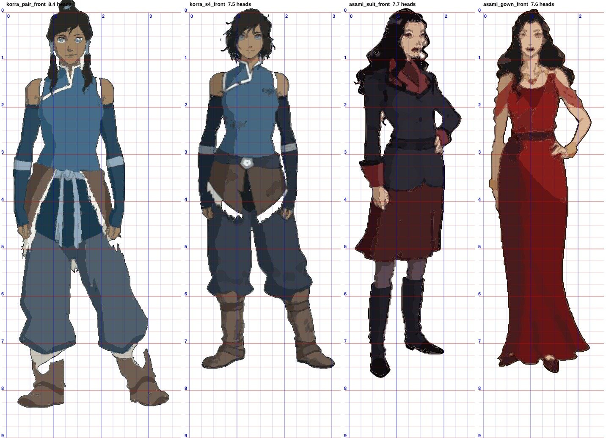
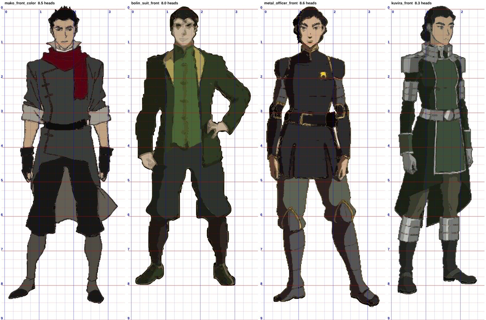
*One head = crown to chin. Horizontal lines every quarter head.*

### 4.1 Proportions

Positions are in heads below the crown; widths are in heads.

| | Korra (S1) | Korra (S4) | Asami (suit) | Asami (gown) | Mako | Bolin | Officer | Kuvira (3/4) |
|---|---|---|---|---|---|---|---|---|
| Total height | 8.4 | 7.5 | 7.7 | 7.6 | 8.5 | 8.0 | 8.6 | 8.3 |
| Chin | 1.0 | 1.0 | 1.0 | 1.0 | 1.0 | 1.0 | 1.0 | 1.0 |
| Shoulder line | 1.6 | 1.55 | 1.5 | 1.5 | 1.6 | 1.45 | 1.55 | 1.4–1.9 |
| Shoulder span | 1.9 | 1.7 | 1.6 | 1.65 | 2.25 | 2.45 | 2.2 | – |
| Waist or belt | 3.45 | 3.2 | 2.85 | 2.7 | 3.35 | – | 3.15 | 3.1 |
| Waist width | 1.1 | 1.1 | 0.9 | 0.8 | 1.25 | – | 1.15 | – |
| Fingertips | 5.05 | 4.6 | 4.5 | – | 4.95 | 4.9 | 5.0 | 4.9 |
| Legs first seen apart | 5.1 | 4.7 | hidden | hidden | 4.9 | 4.65 | 4.9 | hidden |
| Knee | hidden | 5.7 | 5.4 | hidden | 6.2 | 5.9 | 6.1 | 6.5 |
| Lower-leg gather or boot top | 7.3 | 6.1 | 5.9 | – | 6.5 | 6.3 | 6.4 | 7.0 |
| Feet apart (centres) | 2.1 | 1.9 | 0.9 | – | 2.0 | 2.0 | 2.6 | – |

What this shows:

- Figures are 7.5 to 8.6 heads tall. The two Korra sheets differ by almost a head; that is partly
  the measurement error noted in section 1 and partly two different drawings.
- As a share of height: shoulders at 18–21%, waist or belt at 36–43%, fingertips at 58–61%
  (mid-thigh), knee at 70–76%.
- The belt sits higher on Asami (36–37%) than on Korra, whose sash rides on the hips (41–43%).
- Every outfit covers the hips, so the true crotch is never visible. The legs are first seen apart
  at 57–63% of height.
- Men are broader at the shoulder (2.25–2.45 heads) than women (1.6–1.9). Korra is the broadest
  woman. The officer reaches 2.2 only because of shoulder plates.
- Upper arms are thick: Korra's sleeve is about 0.43 heads wide, Mako's about 0.5.

### 4.2 Build

| Character | Build |
|---|---|
| Korra | Athletic. Square shoulders, visibly muscled upper arms, straight waist, strong legs. |
| Asami | Slim. Narrow shoulders, clear waist (0.8–0.9 heads), long neck, long lower legs. |
| Mako | Tall and lean. Wide shoulders over narrow hips, long legs. |
| Bolin | Stocky. The widest shoulders, thick neck, deep chest, short thick lower legs. |
| Officer | Tall and narrow, very long legs, widened by armour plates. |
| Kuvira | Tall, straight posture, widened at the shoulders by pauldrons. |

### 4.3 Stance and pose

- The default is a planted A-stance: feet about two heads apart, toes turned out, weight even.
  Korra, Mako, Bolin and the officer all stand this way; the officer's is the widest (2.6 heads).
- Arms hang slightly away from the body with the elbows a little bent, hands loosely curled at
  mid-thigh.
- Asami is the exception: feet under a head apart, one knee forward, one hand on the hip, the
  shoulders tilted against the hips.
- Bolin often has one fist on the hip, which pushes that elbow far outside the silhouette.
- Front views are rarely perfectly square: the feet and hips are usually turned a few degrees.

### 4.4 Hands and feet

- A hanging hand is three overlapping forms: the back of the hand, the curled finger mass, and the
  thumb in front. At body-sheet size the fingers are suggested by two short lines; in close-ups
  (Kuvira's and Mako's gloved hands) each finger is its own rounded form.
- A fist is the back of the hand, a row of four rounded finger ends (index largest) and the thumb
  wrapped across the front, with one knuckle crease.
- Both are built by rule in `style/lok_style.js` (`LOK.hand`), measured from the Korra references.
- Feet are always in footwear. A boot is one silhouette for shaft and foot, a shadow strip down one
  side, a thin shadow under the sole, one or two crease lines at the toe, and whatever cuff or
  strap the design has (`LOK.furBoot`).

### 4.5 Views

Silhouette width as a share of height:

| Set | Front | 3/4 | Side | Back |
|---|---|---|---|---|
| Korra S4 | 0.38 | 0.28 | – | 0.32 |
| Korra S1 | 0.32 | 0.27 | 0.20 | 0.29 |
| Bolin (suit) | 0.41 | 0.34 | 0.27 | 0.34 |
| Officer | 0.38 | 0.26 | 0.21 | 0.33 |

(Poses differ between views, so these are indicative.)

- **3/4**: the far shoulder and arm shorten and tuck behind the torso; the near arm overlaps the
  torso edge; closures and centre lines move toward the far side; both feet point the same way.
- **Side**: the body is about half as wide as the front. The posture is an S: chest forward, small
  of the back hollow, head slightly forward on the neck, knees a little bent. The near arm hangs
  over the torso and hides most of it. Layers that wrap the hips (pelts, coat tails, skirts) stick
  out behind.
- **Back**: the same silhouette as the front, simpler inside. Closures, lapels and frog buttons
  disappear; back panels are plain with one centre seam or a few shoulder-blade fold lines; hair
  or the collar piece covers the neck; anything hanging at the back (coat tails, a pelt, long hair) becomes the largest
  shape.

---

## 5. Clothes

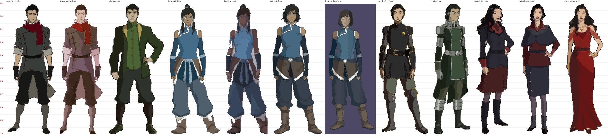

### 5.1 The same nine sections on everyone

Every outfit fills the same slots, top to bottom:

1. Hair
2. Face and neck
3. Collar piece
4. Torso garment
5. Sleeves or arm coverings, with a contrasting band
6. Waist piece
7. Over-layer hanging from the waist
8. Legs
9. Footwear

A new outfit is a new choice in each slot. The body under it barely changes.

### 5.2 What goes in each slot

| Slot | Korra S1 | Korra S4 | Mako | Bolin (suit) | Asami (suit) | Asami (capelet) | Asami (gown) | Officer | Kuvira |
|---|---|---|---|---|---|---|---|---|---|
| Collar | high collar, white trim, diagonal closure | same | scarf with one long tail over a tall grey collar | mandarin collar, wide lined lapels | wide red lapels | capelet over the shoulders, red collar | open neckline, necklace | stand collar | metal gorget |
| Torso | fitted sleeveless top | same, darker | double-breasted tunic, three frog fasteners | open jacket over a buttoned vest | fitted jacket | blouse under the capelet | fitted bodice | plated tunic with piping | tabard over a long coat |
| Arms | bare shoulders, sleeve from mid upper arm, light band at the elbow | bare shoulders, long dark sleeve to the hand | sleeves rolled to a light cuff, bare forearms, fingerless gloves | full sleeves | full sleeves, red cuffs | full sleeves | sheer off-shoulder sleeves, bracelets | plates on shoulder and forearm, gloves | pauldrons, bracers, gloves |
| Waist | sash tied in front, two long tails | belt with a round medallion | plain belt | none (vest hem) | narrow belt | wide belt | narrow belt | belt with buckle | metal belt |
| Over-layer | brown pelt with white fur edge, over a dark panelled apron | shorter split pelt with fur edge | tunic skirt, split, one longer tail | jacket skirt | flared knee skirt | pencil skirt with buttons | floor-length skirt | tunic skirt | coat tails to the knee |
| Legs | baggy pants gathered at the boot | same, darker | baggy knickers gathered under the knee, leg wraps | baggy knickers, dark stockings | stockings | tights | hidden | fitted pants, knee guards | fitted pants, knee armour |
| Feet | boots with a pointed white fur cuff | taller plain boots with straps | flat shoes | shoes | heeled knee boots | heeled ankle boots | shoes | armoured boots | greaves over boots |

### 5.3 How garments are layered

From the clean Korra figure, back to front. Other outfits follow the same logic.

1. Footwear
2. Skin (anything bare)
3. Leg garment
4. Torso garment
5. Arm coverings, then their bands
6. Collar, and panels that hang in front
7. Wraps round the hips
8. Trims on those wraps (fur, piping)
9. Waist piece and its hanging ends
10. Hair, then hair ties
11. Face features
12. Interior ink lines

The rule behind the order: whatever sits further out on the body is drawn later, and trims are
drawn after the thing they trim.

### 5.4 How cloth is drawn

- **Fitted cloth** (tops, jackets, fitted pants): the silhouette follows the body; one shadow strip
  on the viewer's left; one or two seam lines; almost no folds.
- **Baggy cloth** (Korra's pants, Mako's and Bolin's knickers): a wide outline that bulges just
  above where it is gathered; two to four short fold lines radiating from the gather; a shadow band
  along the lower and inner edge.
- **Hanging cloth** (sash tails, scarf tail, coat tails, skirts): long straight-sided shapes ending
  in a clean angled or pointed edge; vertical fold lines; the shadow on one long side.
- **Fur**: a white or cream band with a zig-zag edge of pointed tufts, and a grey shadow tone
  (`#f0f0e8` over `#c6c3b8`).
- **Armour**: separate plates, each a closed shape with its own outline, shaded in two to four flat
  greys.

### 5.5 Trims and accents

Every outfit has one light or bright trim colour that outlines its construction:

| Character | Trim | Where |
|---|---|---|
| Korra | white | collar edge, diagonal closure, armholes, fur edges |
| Mako | light grey | collar, rolled cuffs |
| Bolin (suit) | yellow-green | lapel lining, frog buttons |
| Asami | red | lapels, cuffs, collar |
| Officer | gold | piping along plate edges, badge, buckle |
| Kuvira | silver-grey | tabard edge, all armour |

### 5.6 Palettes

Base colour, with its shadow after the slash where measured. Taken from the cleanest front sheet of
each outfit.

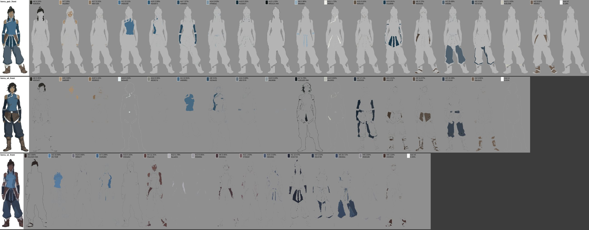
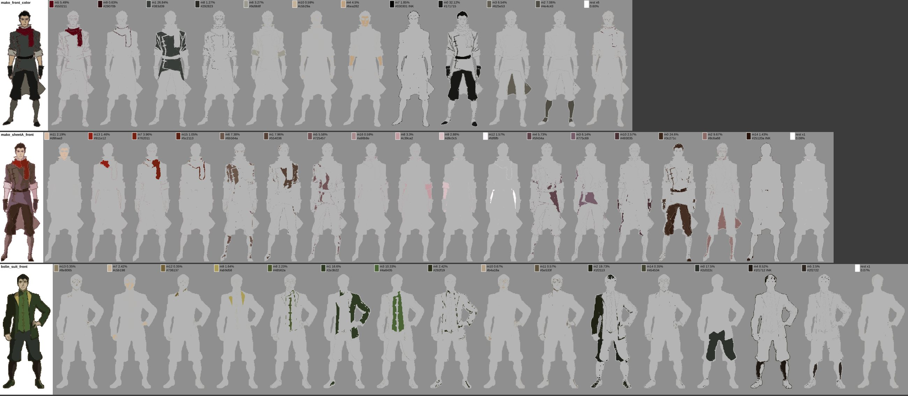
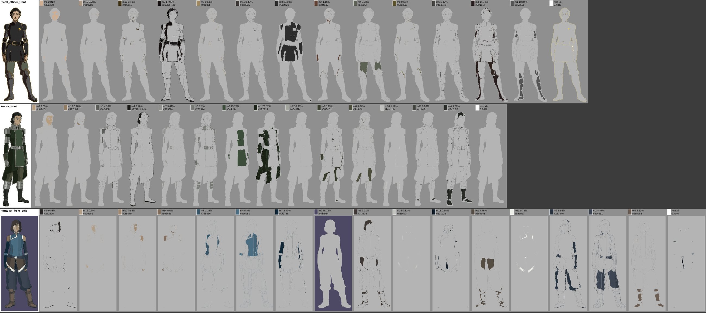
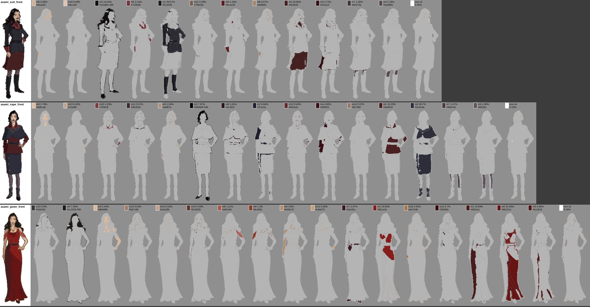
*Each row: the figure, then the visible area of each of its materials.*

| Character | Skin | Hair | Main colours |
|---|---|---|---|
| Korra S1 | `#a18567` / `#7a5d45` | `#282924` | top `#456c89` / `#2e5872`; sleeves `#29485c` / `#1a394b`; apron `#1a394b`; bands and sash `#92abbc` / `#7b92a1`; pelt and boots `#6f5f52` / `#50433a`; pants `#4f5f6c` / `#374753`; white `#f0f0e8` / `#c6c3b8` |
| Korra S4 | `#a88d6f` / `#836b52` | `#2b2a27` | top `#466881` / `#324e63`; sleeves `#26303b`; pelt `#574d44` / `#41372f`; pants `#37414d` / `#26303b`; boots `#6e5e51` / `#41372f` |
| Mako | `#bea282` | `#171715` | scarf `#550211` / `#29070b`; tunic `#383d39`; collar and cuffs `#9d9b8f`; tunic tail `#625e53`; pants, gloves, belt, shoes `#171715`; leg wraps `#4e4c43` / `#292823` |
| Bolin (suit) | `#c5b198` / `#b4a18a` | `#1f1712` | jacket `#2e3b22` / `#292f19`; vest `#4a6435` / `#48562a`; lapel lining `#ab9d58`; pants `#2d322c` / `#1f2113`; stockings `#2f2722` |
| Asami (suit) | `#d1ae91` / `#a5856c` | `#110d0e` | jacket `#212026`; lapels and cuffs `#723538` / `#5e1e20`; skirt `#442020` / `#311113`; stockings `#5a4950` / `#44373a` |
| Asami (capelet) | `#ddbca0` / `#ad8f7a` | `#080508` | capelet and skirt `#2e2e3a` / `#1f1e2a`; blouse `#4a2022` / `#380f15`; collar `#783e3f`; tights `#5f525c` / `#493c45` |
| Asami (gown) | `#dbb899` / `#b28e70` | `#1c1919` | gown `#661514` / `#511818`; lighter panel `#851e1b`; dark drape `#481b1c`; sleeves `#a95246`; gold `#c9a073` |
| Officer | `#d0ae90` | `#160f0f` | tunic `#2c2c2c` / `#291e1e`; plates and boots `#555555` / `#484642`; pants `#5c6254`; knee guards `#604132`; piping `#9d885f` |
| Kuvira | `#b69d7e` / `#927d63` | `#2a2c28` | coat `#192214`; tabard `#3c4d3a` / `#383c2d`; armour `#767974` with `#5b5d58`, `#91938e`, `#bec1bb`; pants `#4d4e3c` |

Colour identity by group: blue-greys with brown for the Water Tribe (Korra); charcoal with one
red accent (Mako); greens (Bolin, Kuvira); near-black with gold (officer); navy and maroon or red
(Asami).

---

## 6. Faces

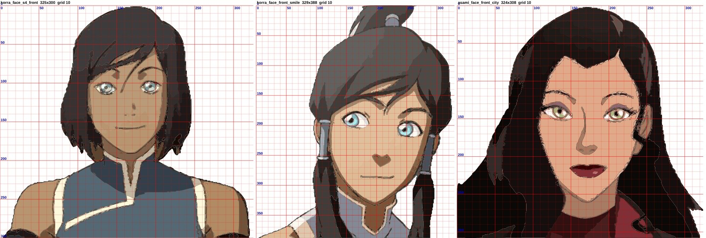
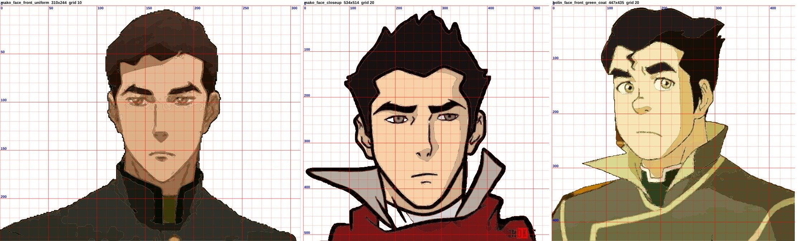
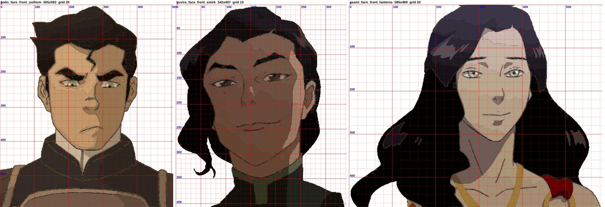

### 6.1 Layout (front view)

Measured from the top of the hair to the chin on nine faces:

| Feature | Position | Notes |
|---|---|---|
| Brows | 40–47% | lower on men, and lower still when frowning |
| Eyes (pupil line) | 49–55% | almost exactly halfway |
| Nose base | 70–75% | Bolin's is higher (64–71%) because his jaw is deep |
| Mouth | 81–85% | |
| Chin | 100% | |

Widths, relative to the face width at eye level:

| | Korra | Asami | Mako | Bolin |
|---|---|---|---|---|
| One eye | 0.28–0.29 | 0.22–0.27 | 0.23–0.24 | 0.26 |
| Distance between eye centres | 0.56–0.63 | 0.55–0.59 | 0.45–0.49 | 0.45 |

The two women have larger, wider-set eyes; the two men have narrower eyes set closer together on a
wider face.

### 6.2 The features

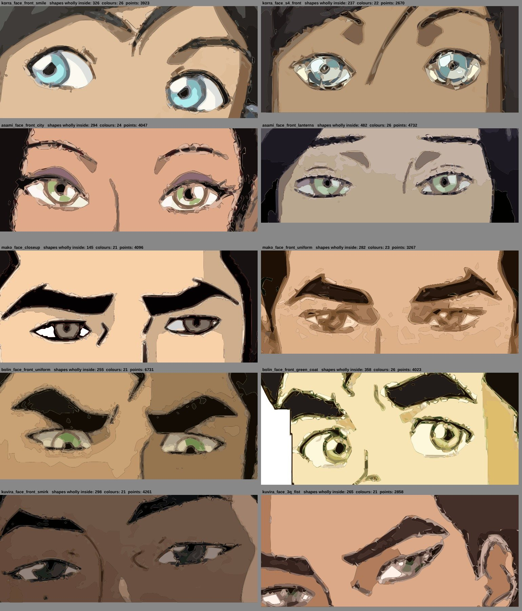

- **Eye.** Six flat pieces: the white (an almond with a sharp inner corner); the iris (a circle
  partly cut off by the upper lid, with a thin darker ring); a small pupil; one white highlight on
  the upper side; a heavy upper lid (thickest at the outer end, often with a flick); a thinner
  lower lid line.
- **Brow.** A solid filled shape in the hair colour, thick at the inner end and tapering outward.
  It is a shape, not a stroke.
- **Nose.** From the front: a small shadow wedge under the tip, two tiny nostril marks, and one
  short line for the bridge on the shadow side only. There is no outline around the nose.
- **Mouth.** One line, slightly curved, sometimes with a short line under it for the lower lip.
  Only Asami has filled lips (dark red, upper lip darker than lower).
- **Ear.** A skin shape at the level between the eyes and the nose base, with one or two short
  inner lines.
- **Jaw.** One continuous outline from ear to chin with a visible corner. It is the main thing that
  separates one face shape from another.

### 6.3 Shading on the face

- Skin is one base and one shadow about 15–20 lightness units darker.
- There is always a shadow under the jaw on the neck.
- In many screenshots a single large shadow covers one side of the face, with a hard edge running
  from the brow down the side of the nose to the chin. Its side depends on the scene's light.
- Small shadow shapes sit under the fringe, under the nose tip and under the lower lip.
- Cheeks are not shaded or coloured.

### 6.4 Three-quarter view

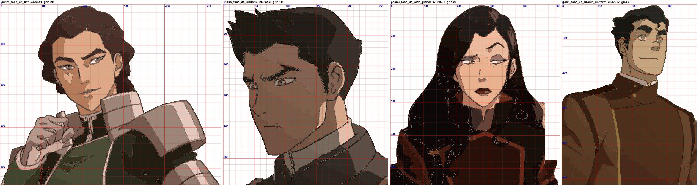

- The far side of the face is compressed: the far eye is narrower and sits against the edge of the
  face or the nose line.
- The nose becomes a line: it runs from the inner end of the far brow down to a pointed tip that
  leans toward the far side.
- The near cheek and jaw are one long curve from the ear to the chin; the far cheek is a short
  curve from the brow to the chin.
- The ear is fully visible on the near side, set well back.
- The mouth shifts toward the far side and shortens on that side.

### 6.5 Side view

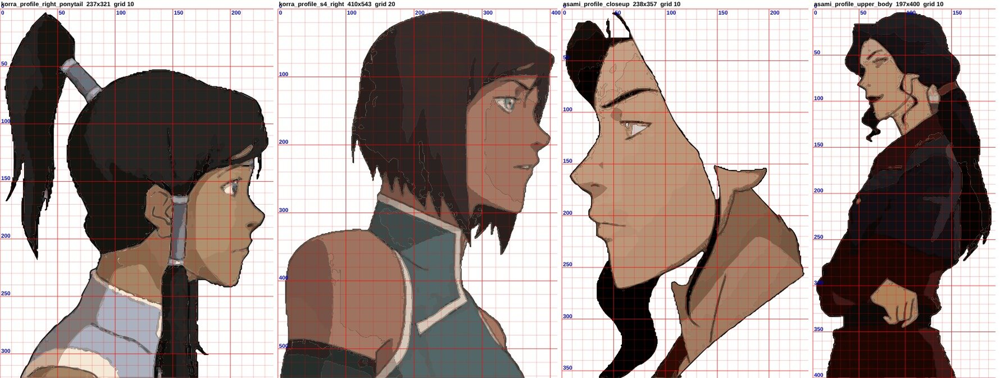

- The front of the face is one contour: forehead, a shallow dip at the brow, nose, a notch under
  the nose, lips, a notch under the lips, chin.
- Measured from the eye to the chin on Korra's two profiles, the nose tip is at about 30% and the
  mouth at about 58%.
- The eye is a wedge: a triangle of white with the iris as a part-circle against its front edge,
  under a heavy lid line.
- The skull is about 0.84 as deep (front to back) as the head is tall (Korra's ponytail profile).
- The ear sits behind the middle of the head; the jaw line runs from the chin up to just below it.
- The neck leans forward, so the head sits ahead of the shoulders.
- Korra's nose is short with a rounded, slightly raised tip. Asami's is longer and straighter with
  a pointed tip, her lips are fuller and her chin smaller.

### 6.6 Expression

Expression is carried by very few shapes:

- **Brows** do most of it. Angry: inner ends drop until they touch the eyes (Bolin, image 29).
  Worried: inner ends rise (Asami, image 25). Confident: one brow raised (Kuvira, image 36).
- **Eyelids** narrow or widen the eye; the iris is cut off more when the lid drops.
- **Mouth**: a smile is the same single line curved up at the ends, usually closed.
- The Bolin sketch sheets (images 30–32) show the extreme end: the whole face squashes and
  stretches, but the same few shapes are used.

### 6.7 What distinguishes each face

| Character | Eyes | Brows | Face shape | Other |
|---|---|---|---|---|
| Korra | largest and roundest; big light-blue iris | thin tapered arches | rounded, wide cheeks, soft chin | brown skin, the darkest of the cast |
| Asami | almond with a pointed outer corner, thick upper lid with a flick, violet shadow shape above, green iris | very thin, high arches | narrower oval, pointed chin | widow's-peak hairline; filled dark-red lips |
| Mako | narrow, about half the height of Korra's; amber-brown iris cut off by the lid | thick, angular, sitting on the eyes | long and angular, straight nose line | |
| Bolin | round and open; green iris | the thickest, blocky | wide, heavy square jaw | forelock curl |
| Kuvira | narrow and slanted; the upper lid extends into a wing | angular, tapered | oval with a sharp chin | beauty mark under one eye |

---

## 7. Hair

Hair is one flat dark shape (two for hair that passes behind the head), outlined, ending in points.
It is the strongest identifier in the silhouette.

| Character | Shape |
|---|---|
| Korra (S1) | A smooth cap with a side-swept fringe; a high tail at the back bound with a light-blue tie; two tails hanging in front of the ears, each bound in a light-blue tube, reaching the collarbone. |
| Korra (S4) | A chin-length bob, parted to one side, ends cut into points that curve inward. |
| Mako | Short, swept up and back into four or five spikes; pointed sideburns. |
| Bolin | A short rounded cap, higher at the front, with one curl falling on the forehead. |
| Asami | Long and wavy to mid-back, widow's peak, falling in front of one shoulder; tied low at the back in some scenes. |
| Kuvira | Swept back from the face and gathered low behind the head; loose in one scene. |
| Officer | Short and wavy, off the collar. |

Hair highlights, where present, are one lighter shape following the curve of the mass.

---

## 8. Character sheets

Each lists the figures to look at first.

### Korra

- **Look at:** `korra_pair_front` (cleanest body), `korra_s4_front`, `korra_face_s4_front`,
  `korra_face_front_smile`, `korra_profile_right_ponytail`, `korra_profile_s4_right`.
- **Body:** athletic, 7.5–8.4 heads, shoulders 1.7–1.9 heads, thick upper arms, wide planted stance.
- **Outfit (S1):** white-trimmed high collar with a diagonal closure; fitted sleeveless blue top;
  bare shoulders; dark blue sleeves from mid upper arm with a light band at the elbow; light-blue
  sash with two long tails; brown pelt edged with white fur over a dark panelled apron; baggy
  blue-grey pants; brown boots with a pointed white fur cuff.
- **Outfit (S4):** the same idea, darker and plainer: long dark sleeves to the hand, a belt
  with a round medallion, a shorter split pelt, taller plain boots.
- **Face:** rounded with wide cheeks; the largest eyes of the cast with a big light-blue iris; thin
  arched brows; short nose.

### Mako

- **Look at:** `mako_front_color`, `mako_sheetA_*` (four views), `mako_face_front_uniform`,
  `mako_face_3q_uniform`, `mako_face_closeup` (tutorial drawing, heavy lines).
- **Body:** tall and lean, 8.5 heads, shoulders 2.25 heads, narrow hips.
- **Outfit:** red scarf with one long tail over a tall grey collar; charcoal double-breasted tunic
  with three frog fasteners; sleeves rolled to a grey cuff; black fingerless gloves; black belt;
  split tunic skirt with one longer tail; black knickers gathered under the knee; grey leg wraps;
  flat black shoes.
- **Face:** long and angular; narrow amber-brown eyes; thick angular brows low on the eyes.

### Bolin

- **Look at:** `bolin_suit_*` (four views), `bolin_tunic_*` (three views, photographed and
  colour-shifted), `bolin_face_front_green_coat`, `bolin_face_front_uniform`, `bolin_head_01`–`10`.
- **Body:** stocky, 8 heads, shoulders 2.45 heads, thick neck, deep chest.
- **Outfit (suit):** dark green jacket with yellow-lined lapels over a lighter green buttoned vest;
  dark knickers; dark stockings; shoes.
- **Face:** wide with a heavy square jaw; round green eyes; the thickest brows; forelock curl.

### Asami

- **Look at:** `asami_suit_*`, `asami_cape_*`, `asami_gown_*`, `asami_face_front_city`,
  `asami_face_3q_side_glance`, `asami_profile_upper_body`.
- **Body:** slim, 7.6–7.7 heads, shoulders 1.6 heads, waist 0.8–0.9 heads, narrow stance with one
  hand on the hip.
- **Outfits:** fitted dark jacket with red lapels and cuffs over a flared maroon skirt, stockings
  and heeled knee boots; or a navy capelet and pencil skirt over a maroon blouse; or a red
  floor-length gown with sheer off-shoulder sleeves and gold jewellery.
- **Face:** narrow oval with a pointed chin; almond eyes with a heavy flicked lid and violet
  shadow; very thin high brows; the only filled lips.

### Kuvira

- **Look at:** `kuvira_front`, `kuvira_back`, `kuvira_face_3q_fist`, `kuvira_face_3q_smile`.
- **Body:** tall, 8.3 heads, upright.
- **Outfit:** metal gorget, pauldrons, bracers, belt and knee armour in four greys; dark green long
  coat; lighter green tabard edged in silver; olive pants; dark boots.
- **Face:** oval with a sharp chin; narrow slanted eyes with a winged lid; angular brows; beauty
  mark.

### Metalbender officer

- **Look at:** `metal_officer_*` (four views).
- **Body:** tall and narrow, 8.6 heads, the widest stance.
- **Outfit:** near-black plated tunic with a stand collar and gold piping; grey plates on the
  shoulders and forearms; belt with buckle; olive pants; brown knee guards; grey armoured boots.
- **Face:** not available at usable size.

---

## 9. Drawing a new character in this style

This is the procedure the references imply, in Canvas terms.

1. **Set the body.** Pick a height of 7.5–8.5 heads. Place the shoulder line at 1.5–1.6 heads, the
   waist at 2.7–3.4, fingertips at about 60% of height, knees at about 72%. Shoulder span 1.6–1.9
   heads for a woman, 2.25–2.45 for a man. Stand the figure with the feet about two heads apart.
2. **Choose one option for each of the nine slots** in section 5.1.
3. **Choose the palette.** Two or three related muted colours for the garments, one skin tone, one
   near-black hair colour, one light trim, and at most one stronger accent. Derive each shadow from
   its base with the table in section 3.3.
4. **Build every form as a closed path** of long curves with sharp corners.
5. **Draw back to front** in the order of section 5.3. For each form:
   - `fill` the base colour;
   - `save`, `clip` to the form, `fill` the shadow shape (a strip on the viewer's left, plus a band
     under whatever overlaps it), `restore`;
   - `stroke` the outline in the ink colour at about 0.06–0.1% of the figure's height.
6. **Add the trim** shapes after the garment they belong to.
7. **Draw the face** with the layout of section 6.1: eyes halfway, nose base at about 72%, mouth at
   about 83%. Build each eye from its six pieces. Fill the brows as shapes. Pick eye size, eye
   spacing, brow weight and jaw shape to set the character (section 6.7).
8. **Draw the hair** as one or two flat shapes ending in points, the back mass first and the front
   mass after the face.
9. **Add interior lines last**, and few of them: seams, two to four folds at each gather, a
   knuckle crease.

---

## 10. Where the current generators depart from the references

Comparing the constants in `style/generator.js` with the measurements above:

| | Generator | References |
|---|---|---|
| Shoulder span, women | 1.28 heads | 1.6–1.9 |
| Shoulder span, men | 1.68 heads | 2.25–2.45 |
| Waist width, women | 0.72 heads | 0.8–1.1 |
| Waist width, men | 0.92 heads | about 1.25 (Mako) |
| Upper-arm width, women | 0.24 heads | about 0.43 |
| Upper-arm width, men | 0.31 heads | about 0.5 |
| Stance (feet apart) | about 0.8 heads | about 2 heads |
| Eye line, mouth line | 0.56, 0.83 | 0.49–0.55, 0.81–0.85 (matches) |

So its figures come out narrow-shouldered, thin-armed and standing to attention, which is what the
feedback screenshot `feedback_screenshots/06_style_generator_feedback.png` shows. The face layout
it uses is right.

`generator/engine.js` (the traced-parts mixer) cuts whole traces into four horizontal bands. Because
a trace's layers are colours and not garments (section 2.1), it cannot move or recolour one garment
without affecting everything else that shares its colour or its band.

---

## 11. What is uncertain or missing

- **Head counts** are good to about ±0.3 heads, because the heads on the body sheets are only
  60–80 pixels tall.
- **Line weight on bodies** is an upper bound; the close-ups give the better figure.
- **Colours from screenshots** include scene lighting. The palettes in section 5.6 come from the
  body sheets only; face-only details such as iris colour are less certain.
- **Photographed sheets** (Mako's turnarounds, Korra S1, Bolin's tunic) are colour-shifted and were
  not used for palettes.
- **The metalbender officer** has no face reference.
- **Side views of faces** are large enough to measure only for Korra and Asami.
- **Kuvira's front face** is tilted, so her face proportions were not measured.
- **Asami's close side profile** is missing its hair (black on a black background).
- **Backs of heads and tops of heads** appear only on the small body sheets.
- **Children, older characters and heavier builds** are not in the library at all; nothing here
  says how the style draws them.
- **Only one figure** has the clean named-part structure. The layering order in section 5.3 is
  taken from it and extended to the other outfits by observation.
